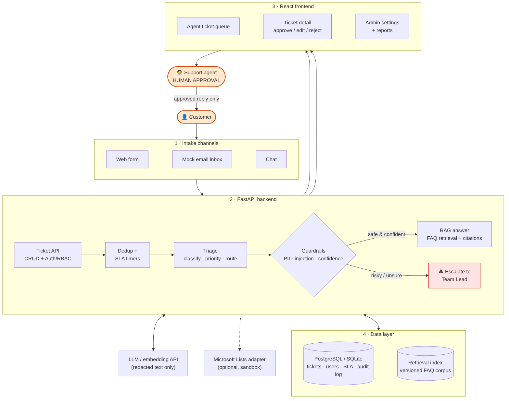

# Architecture & Plan — Helix Agent (Week 1)



*Diagram source: `architecture.mmd` (Mermaid — renders directly on GitHub).*

## 1. Request flow
1. Customer submits a ticket via **web form, mock email or chat**.
2. **Ticket API** stores it (status `New`) and checks auth/role.
3. **Dedup + SLA**: links repeat tickets to an existing thread and starts SLA timers.
4. **Triage**: predicts category, priority and team with a confidence score (rules in Week 1 → ML in Week 2).
5. **Guardrails**: redacts PII, checks for prompt injection, checks confidence and escalation rules.
   - Safe & confident → **RAG** retrieves approved FAQs and drafts a reply **with citations**.
   - Risky / unsure → **Escalate to Team Lead** (no AI answer drafted).
6. Support agent reviews in the **React UI** and **approves, edits or rejects**.
7. Only the **approved reply** reaches the customer. Every AI suggestion and human decision goes to the **audit log**.

## 2. Tech stack
| Layer | Choice | Reason |
|---|---|---|
| Backend API | Python 3.11 + **FastAPI** | Fast, typed, auto Swagger docs |
| Database | **PostgreSQL 16** (main, driver `psycopg`); SQLite fallback when `DATABASE_URL` is not set | Production-ready; same code and tests run on both |
| Migrations | Numbered SQL files + runner (`app/db.py`) | Versioned schema changes, no extra dependency |
| Classifier | scikit-learn (TF-IDF + Logistic Regression) | Explainable baseline, cheap |
| Retrieval | TF-IDF + cosine (Week 3); sentence embeddings + FAISS/Chroma to compare in Week 7 | Local, no cloud cost |
| LLM | Not used yet — drafts are extractive from approved FAQs; provider to be approved | Used only on redacted text |
| Workflow | Plain Python; **LangGraph only if needed** | Keep it simple |
| Frontend | React + Vite | Agent queue and admin UI |
| Testing | pytest + seeded scenarios | Evidence for every week |
| DevOps | GitHub (issues, weekly commits), Docker Compose | Reproducible setup |

## 3. API design (draft)
| Method | Endpoint | Purpose | Week |
|---|---|---|---|
| POST | `/tickets` | Create ticket | 2 |
| GET | `/tickets?status=&priority=&team=` | List / filter queue | 2 |
| GET | `/tickets/{id}` | Ticket detail + suggestions | 2 |
| PATCH | `/tickets/{id}` | Update status, priority, team, assignee | 2 |
| DELETE | `/tickets/{id}` | Soft delete (admin only) | 2 |
| POST | `/tickets/{id}/triage` | Run classify + priority + route | 2 |
| POST | `/tickets/{id}/answer` | RAG draft answer with citations | 3 |
| POST | `/tickets/{id}/decision` | Agent accepts / edits / rejects a suggestion | 4 |
| POST | `/tickets/{id}/escalate` | Manual escalation with reason | 3 |
| GET | `/tickets/{id}/audit` | Audit trail for a ticket | 4 |
| POST | `/intake/email` | Mock inbox intake | 5 |
| GET / POST | `/admin/faqs`, `/admin/categories` | Manage FAQs and categories | 8 |
| GET | `/reports/summary` | Volume, SLA, quality metrics | 8 |
| GET | `/health` | Health check | 2 |

## 4. Database schema (draft)
```
users            (id, name, email, role[customer|agent|lead|admin], team_id, created_at)
teams            (id, name)
categories       (id, name, default_team_id, active)
app_settings     (key, value)   -- records the domain (kgit) of this database
tickets          (id, customer_id, channel, subject, body, status, category_id, priority,
                  team_id, assignee_id, thread_id, sla_due_at, sla_breached, created_at, updated_at)
ticket_messages  (id, ticket_id, sender_type[customer|agent|ai_draft], body, created_at)
ai_suggestions   (id, ticket_id, type[category|priority|team|answer], value, confidence,
                  sources_json, model_version, latency_ms, cost_usd, created_at)
human_decisions  (id, suggestion_id, agent_id, action[accept|edit|reject], final_value, reason, created_at)
escalations      (id, ticket_id, reason, raised_by[system|agent], resolved_by, created_at, resolved_at)
faqs             (id, category_id, question, answer, version, status[draft|approved], approved_by, updated_at)
audit_log        (id, actor, action, entity, entity_id, details_json, created_at)
```

## 5. UI screens (Week 4+)
| Screen | Main parts |
|---|---|
| **Ticket queue** | Table: ID, subject, category, priority badge, team, SLA countdown, status; filters |
| **Ticket detail** | Conversation, AI suggestions with confidence, FAQ sources, Approve / Edit / Reject buttons |
| **Admin** | Categories, teams, FAQs (versioned), SLA rules, users and roles |
| **Reports** | Ticket volume, SLA breaches, AI acceptance rate, classification accuracy |

## 6. Deployment plan
| Stage | Where | How |
|---|---|---|
| Local dev (Weeks 1–8) | Laptop | `uvicorn` + PostgreSQL (installer or `docker compose up -d`), `npm run dev` |
| Integration (Week 6+) | Docker Compose | api + postgres + frontend containers |
| Pilot (Week 9) | KGIT sandbox / VM (mentor approval) | Docker Compose, `.env` secrets, daily DB backup |
| Release (Week 11) | GitHub tagged release `v1.0.0` | Setup guide + config example (no secrets) |

**Security basics from day one:** secrets only in `.env` (git-ignored), role-based access on every endpoint, PII redaction before any external API call, synthetic data only.
