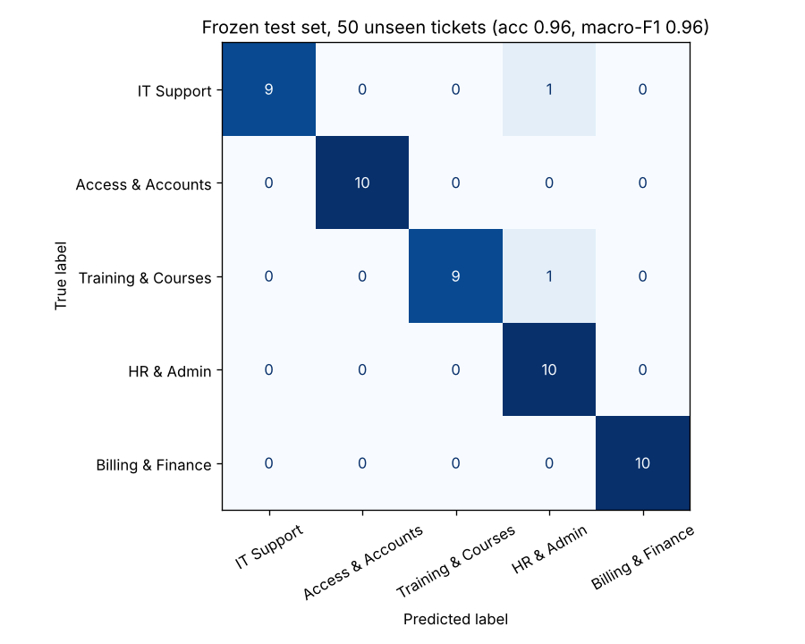

# Week 2 Report — Backend, Classification, Priority, Testing
**Period:** 11 Nov – 17 Nov 2026 · **Planned:** 34 h · **Intern:** Rajeshwari R
**Domain:** KGIT helpdesk — categories **assumed**, to be confirmed by the mentor (DEC-08)

| Work package | Acceptance evidence | Where |
|---|---|---|
| Backend · 10 h | Running API + migration, **PostgreSQL schema** | `app/main.py`, `app/routers/tickets.py`, `app/migrations/postgres/`, `app/db.py`, `docs/postgres_setup.md` |
| Classification · 10 h | Metrics + confusion matrix | `ml/train_classifier.py`, `docs/kgit/week2_classifier_metrics.json`, `docs/kgit/week2_confusion_matrix.png` |
| Priority · 8 h | Tested routing engine | `app/services/priority.py`, `app/services/triage.py`, `tests/test_triage_engine.py` |
| Testing · 6 h | Test suite | `tests/` — run on **both PostgreSQL 16 and SQLite** |

KGIT categories → teams: **IT Support** → IT Service Desk · **Access & Accounts** → Identity & Access Team · **Training & Courses** → Learning Team · **HR & Admin** → HR & Admin Team · **Billing & Finance** → Finance Team.

---

## 1. Backend — ticket API + PostgreSQL schema
- **FastAPI** app with Swagger docs at `/docs`.
- **PostgreSQL 16** is the main database (`DATABASE_URL=postgresql://…/helix_kgit`, driver `psycopg`). **SQLite** remains as a zero-setup fallback when `DATABASE_URL` is not set.
- Schema in numbered migration files: `app/migrations/postgres/0001_init.sql` … `0003_app_settings.sql` (SQLite equivalents in `app/migrations/sqlite/`). `app/db.py` applies each file once and records it in `schema_migrations`.
- Tables: `teams`, `categories`, `users`, `tickets`, `ai_suggestions`, `faqs` (Week 3), `app_settings`.
- Categories and teams come from `data/kgit/domain.json`, so a future client only needs a new data folder (supports the Week 10 "reusable client setup").
- Setup on Windows (installer or Docker): `docs/postgres_setup.md`, `docker-compose.yml`.

| Method | Endpoint | Purpose |
|---|---|---|
| POST | `/tickets` | Create ticket → automatically triaged |
| GET | `/tickets?status=&priority=&team=&category=&escalated=` | Queue (Critical first, then oldest) |
| GET | `/tickets/{id}` | Ticket detail |
| PATCH | `/tickets/{id}` | Human override (status, category, priority, team, assignee) |
| DELETE | `/tickets/{id}` | Soft delete (kept for audit) |
| POST | `/tickets/{id}/triage` | Re-run triage with full explanation |
| GET | `/tickets/{id}/suggestions` | Stored AI suggestions |
| GET | `/health` | Health check + active domain |

## 2. Classification
**Model:** TF-IDF (word 1–2-grams + character 2–5-grams) → Logistic Regression (`tfidf-logreg-v1`).

### Honest evaluation setup (dev / frozen test split)
| File | Tickets | Used for |
|---|---|---|
| `data/kgit/train_tickets.csv` | 450 | Training (template-generated) |
| `data/kgit/tickets.csv` | 50 | Training (hand-written, weighted 3×) — was the first test set |
| `data/kgit/dev_tickets.csv` | 50 | Development: errors studied, then added to training |
| `data/kgit/test_tickets.csv` | 50 | **Frozen final test** — never trained or tuned on; SHA-256 in `data/kgit/test_set_frozen.sha256`, checked by a test |

The model was **chosen by 5-fold cross-validation on the hand-written tickets** (`ml/select_model.py`, `docs/kgit/model_selection.json`): Logistic Regression 0.95, calibrated linear SVM 0.96, Complement NB 0.92 → Logistic Regression kept (within 1 ticket of the best, simpler and explainable).

### Results on the frozen test set (50 unseen tickets)
| Measure | Week 1 keyword rules | Before improvement | **After improvement** |
|---|---|---|---|
| Category accuracy | 0.76 | 0.84 | **0.96** (macro-F1 0.96) |
| Priority accuracy | 0.54 | 0.64 | **0.80** |
| Risky tickets caught (escalation recall) | 0.29 | 0.71 | **1.00** |
| All three correct | — | 0.54 | **0.76** |
| Flagged for human review | — | 12 | 3 |

Files: `docs/kgit/test_set_week1_rules.json`, `test_set_before.json`, `test_set_after.json`, `week2_classifier_metrics.json`.

**What improved accuracy**
1. **More realistic training data** — the 100 hand-written tickets added to training (weighted 3×) and templates widened from 300 to 450 covering more helpdesk topics.
2. **General helpdesk priority rules** — e.g. "not updating / not visible / unpaid / flickering" → Medium; "code rejected / account disabled / money taken from account / revoke a leaver's access" → High; "virus / infected / pretending to be HR / someone has my password / threats" → Critical.
3. **Removed leftover e-commerce rules** ("demo", "pickup", "delivery address") that inflated priority.

**Honest limits**
- The test tickets, templates and rules were all written by the same person, so even the frozen-test score is likely **higher than on real KGIT tickets**. Real anonymised tickets are still needed (DEC-09).
- Remaining test errors (logged as ISS-19 … ISS-21): 2 category, 10 priority (mostly High → Medium), 2 over-escalations (safe side).

**Human-review threshold** (chosen from cross-validation, not the test set): **0.45** → 9 % flagged, 0.99 accuracy on the rest.

## 3. Priority / urgency scoring + routing
- Generic helpdesk signals + KGIT signals from `data/kgit/domain.json` (many users affected, hard deadline / client impact, salary not received, leaver access removal, training delivery failing for a batch).
- **≥5 Critical · ≥3 High · ≥1.5 Medium · else Low**; every matched signal returned as a reason. A "cosmetic only" signal (spelling / wrong name) subtracts 1.5.
- **Routing:** category → team. **Risk** (fraud/phishing/malware, threats to safety, legal/media, privacy request, HR-sensitive, anger, prompt injection, Critical) → **Team Lead**. **Low classifier confidence** → `needs_human_review`.
- **SLA:** due dates from the ticket's **creation time** (fixed in ISS-12).
- Fair checks: frozen test set (above) and **12 seeded scenarios** in new words (12/12).

## 4. Tests
`python -m pytest -q` → **85 passed** (+ 12 API tests when FastAPI is installed).
Same suite verified on **PostgreSQL 16** with `TEST_DATABASE_URL` (each test in a temporary schema).

| File | Covers |
|---|---|
| `test_db_and_repository.py` | migrations once, domain guard, CRUD, soft delete, queue order, filters, SLA from creation time |
| `test_triage_engine.py` | classifier ≥ 0.90 on the frozen test set, test set unchanged (SHA-256), no test ticket in training, 11 priority cases, routing, Team Lead escalation, SLA, PII, 12 seeded scenarios |
| `test_rag_and_guardrails.py` | (Week 3) answers, refusal, escalation, PII, FAQ versioning, category validation |
| `test_api.py` | end-to-end HTTP incl. 422 validation and 404s |
